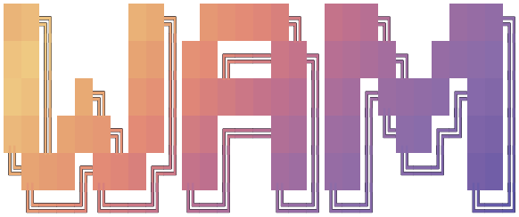

<p align="center">
	
	<br/>
	<i>WoW Addon Manager</i>
	<br/>
	<br/>
	Gestionnaire d'addons pour <b>WoW Forever</b>, en terminal.<br/>
	macOS, Windows et Linux. Node ≥ 24, deux petites dépendances en pur JS.
</p>

## Why 🤷

L'app CurseForge ne fonctionne pas derrière certains proxy (d'entreprise 👀), et mettre à jour 30 addons à la main en dézippant des fichiers, c'est chiant.

`wam` met à jour, cherche, installe et supprime les addons Forever depuis le terminal, avec une vraie interface, et les logos des addons en blocs de couleur.

## Features ✨

- **Mises à jour** : compare chaque addon installé à sa dernière version Forever (CurseForge ou release GitHub) et met à jour en un coup (`U`, ou `wam update`).
- **Recherche** dans le catalogue des ~19 000 addons Forever, installation avec les dépendances obligatoires.
- **Ajout** par lien CurseForge, numéro de projet ou `owner/repo` GitHub, avec les dépendances obligatoires (celles de CurseForge et celles du `## Dependencies` du `.toc`).
- **Reconnaît les addons installés à la main** grâce au numéro CurseForge de leur `.toc`.
- **Addons perso** : un addon qu'on développe reste un lien vers son repo, et bascule entre ce lien et sa dernière release GitHub (`l`, ou `wam release` / `wam dev`).
- Chaque action de l'interface a aussi sa commande, pour les scripts.

## Install 💽

Il faut **Node ≥ 24** (`node -v`) : [nodejs.org](https://nodejs.org), `brew install node` ou `winget install OpenJS.NodeJS`. npm est fourni avec.

```bash
$ npm install -g https://github.com/Firnael/wow-addon-manager/archive/main.tar.gz
```

C'est tout : la commande `wam` est dans le `PATH`, sur macOS, Linux et Windows. Pour mettre à jour wam, relancer la même commande. Pour le désinstaller : `npm uninstall -g wow-addon-manager`.

> Derrière un proxy, si npm lui-même refuse le certificat : préfixer la commande par `NODE_USE_SYSTEM_CA=1` (PowerShell : `$env:NODE_USE_SYSTEM_CA=1; npm install -g …`). wam, lui, prend tout seul les certificats du système.

<details>
<summary>Depuis un clone (pour bosser sur wam)</summary>

```bash
$ git clone https://github.com/Firnael/wow-addon-manager.git
$ cd wow-addon-manager
$ npm link          # installe les dépendances, `wam` pointe sur ce dossier ; mise à jour : git pull
```
</details>

### Premier lancement

1. **Dossier AddOns** : wam cherche `World of Warcraft/_forever_/Interface/AddOns` à l'endroit habituel (`/Applications` sur macOS ; `Program Files`, puis la racine, `Program Files`, `Games`, `Jeux` et `Battle.net` de chaque lecteur sur Windows ; `~/Games` sur Linux). Vérifier avec `wam dir`. Si le jeu est ailleurs :

   ```bash
   $ wam dir "D:\Jeux\World of Warcraft\_forever_\Interface\AddOns"
   ```

2. **Clé CurseForge** (facultative : sans elle, tout marche sauf la recherche et l'installation des dépendances). La créer sur [console.curseforge.com](https://console.curseforge.com) (onglet *API keys*, gratuit), puis :

   ```bash
   $ wam key        # saisie masquée ; la clé est testée avant d'être enregistrée
   ```

3. `wam` ouvre l'interface. Les addons installés à la main sont reconnus s'ils ont un numéro CurseForge dans leur `.toc` (la plupart) ; les autres s'affichent en « source inconnue » : les réinstaller avec `a` pour qu'ils soient suivis. La première recherche construit le catalogue (quelques minutes, puis une fois par semaine).

Sur Windows, utiliser **Windows Terminal** (installé d'office sur Windows 11) : couleurs 24 bits et caractères des logos.

## Usage 🧑‍💻

```bash
$ wam                        # l'interface
$ wam check [addon…]         # versions et mises à jour disponibles
$ wam update [addon…]        # met à jour ce qui est en retard (tout, ou les addons nommés)
$ wam add <source…>          # lien CurseForge, numéro de projet ou owner/repo GitHub (+ dépendances)
$ wam adopt <projet…>        # déjà installé et à jour (app CurseForge) : retient la source sans retélécharger (clé requise)
$ wam remove [-y] <addon…>   # supprime, après confirmation sauf avec -y
$ wam search <mots…>         # catalogue Forever : numéro, nom, téléchargements, auteur
$ wam catalog                # reconstruit le catalogue
$ wam open <addon>           # ouvre la page de l'addon
$ wam release <addon…>       # addon perso : lien -> dernière release GitHub
$ wam dev <addon…>           # retour au lien vers le repo
$ wam key                    # enregistre la clé API CurseForge
$ wam dir [chemin]           # affiche ou règle le dossier AddOns
$ wam version
```

`<addon>` est le nom du dossier ou le titre, sans tenir compte de la casse. Exemples : `wam search questie` puis `wam add 334372` ; `wam add https://www.curseforge.com/wow/addons/tomtom` ; `wam add Questie/QuestieDB` ; `wam update`, puis `/reload` en jeu.

### Interface

- **1 Installés** : chaque addon avec sa version et son état (à jour, ↑ nouvelle version, perso). `u` met à jour l'addon choisi, `U` tout, `r` revérifie, `a` ajoute, `d` supprime, `o` ouvre sa page, `l` bascule un addon perso entre lien et release.
- **2 Rechercher** (`Tab`) : nom, description, auteur ; noms d'abord, puis par téléchargements. `Entrée` installe l'addon et ses dépendances, `R` rafraîchit le catalogue.

### Addons perso : lien ou release

Un addon qu'on développe est un lien dans AddOns vers son repo git, où qu'il soit : le jeu charge le code en cours. wam le montre en « perso (lien) », `wam update` ne le touche pas et `d` refuse de le supprimer.

```bash
# macOS / Linux
$ ln -s ~/chemin/vers/MonAddon "<dossier AddOns>/MonAddon"
# Windows (une jonction : ni droits admin ni mode développeur)
> mklink /J "<dossier AddOns>\MonAddon" C:\chemin\vers\MonAddon
```

`wam release <addon>` remplace le lien par la dernière release GitHub du repo (déduit du remote `origin`) ; l'addon est alors mis à jour comme les autres. `wam dev <addon>` remet le lien. La release attendue est un zip `<Addon>-X.Y.Z-forever.zip`, publié par exemple par un workflow GitHub sur un tag `vX.Y.Z`.

## Tech stack 🤖

- **Node.js ≥ 24**, ESM, rien de natif : `fetch`, `zlib` (extraction des zips), `tls` (certificats du système). Seules dépendances : [pngjs](https://www.npmjs.com/package/pngjs) et [jpeg-js](https://www.npmjs.com/package/jpeg-js) (~800 Ko, pur JS) pour décoder les logos.
- Interface faite main : stdin brut, codes ANSI, écran alternatif, dégradé « retro » repris d'[azotui](https://github.com/Firnael/azotui), en 24 bits si le terminal le gère (`COLORTERM`, ou ce que Node détecte, Windows Terminal compris), sinon 256 couleurs.
- Logos en demi-blocs colorés (`▀`, deux pixels par cellule, deux fois plus fin que les `██` d'azotui). PNG et JPEG ; les autres formats n'affichent pas de logo.
- Optionnels : `git` (remote des addons perso), `gh` (token GitHub pour les repos privés).

<details>
<summary>Sources des addons</summary>

- **CurseForge**, par le numéro de projet du `.toc` (`## X-Curse-Project-ID`). La version retenue est la dernière stable qui annonce un client 1.60.x. Le téléchargement passe par l'API du site (`www.curseforge.com/api/v1/mods/<id>/files`), sans clé.
- **Fiches, dépendances et catalogue** : API officielle (`api.curseforge.com`, en-tête `x-api-key`).
- **Pourquoi un catalogue local** : `/v1/mods/search` répond 403 à ces clés (vérifié le 2026-11-24), alors que le reste de l'API répond. `POST /v1/mods/featured` (filtré sur Forever, `gameVersionTypeId` 88568) renvoie une vingtaine d'addons en sautant ceux de `excludedModIds` : en le rappelant avec tous les ids déjà vus, on parcourt toute la liste Forever. Le catalogue est construit au premier lancement, repris s'il a été interrompu, refait au bout d'une semaine.
- **GitHub** : dernière release, fichier dont le nom contient « forever » et finit par `.zip` (ex. QuestieDB). Le token (`GITHUB_TOKEN`, `GH_TOKEN`, sinon `gh auth token`) donne accès aux repos privés.
- Les addons dont le `.toc` n'a pas de numéro CurseForge sont listés dans `KNOWN` (`src/core.mjs`). Un addon installé depuis wam garde sa source dans l'état.
</details>

<details>
<summary>Fichiers</summary>

Dans `~/.config/wam/` (Windows : `%USERPROFILE%\.config\wam`), ou `$WAM_HOME` :

- `config.json` : `addonsDir` et `apiKey` (droits `600`). La clé peut aussi venir de `CURSEFORGE_API_KEY`.
- `catalog.json` : le catalogue des addons Forever (quelques Mo).
- `logos/` : les logos déjà convertis.
- `state.json` : pour chaque source, le fichier installé, ses dossiers, la date et, pour les addons perso en release, la cible du lien. C'est lui qui dit si un addon est à jour ; sans trace, la version du `.toc` est comparée au nom du fichier en ligne.
</details>

<details>
<summary>Code</summary>

- `bin/wam.mjs` : point d'entrée, vérifie que Node est en version 24 ou plus.
- `src/cli.mjs` : les commandes.
- `src/core.mjs` : lecture du dossier AddOns, versions, installation (dossier remplacé en bloc, ancien remis en place en cas d'échec), suppression.
- `src/curse.mjs`, `src/github.mjs` : les sources. `src/catalog.mjs` : le catalogue et sa recherche.
- `src/zip.mjs` : extraction des zips (stored / deflate).
- `src/platform.mjs` : ce qui change selon l'OS (certificats, ouverture d'une page, liens, dossier par défaut).
- `src/logo.mjs` : les logos (CurseForge, sinon l'avatar GitHub du propriétaire), décodés, réduits à 96 px au plus et dessinés dans un carré fixe en haut du panneau.
- `src/tui.mjs` : l'interface, avec un écran d'accueil d'1,6 s (une touche le passe ; `WAM_SPLASH_MS=10000 wam` le garde 10 s, pour une capture).

Pour tester sans toucher au vrai dossier : `WAM_HOME=/tmp/w` avec un `config.json` dont `addonsDir` pointe ailleurs.
</details>

## TODO 📋

- Tester en vrai sous Windows (jonctions, rendu dans Windows Terminal).
- Une capture d'écran dans ce README.

## Licence

MIT, voir [LICENSE](LICENSE).
